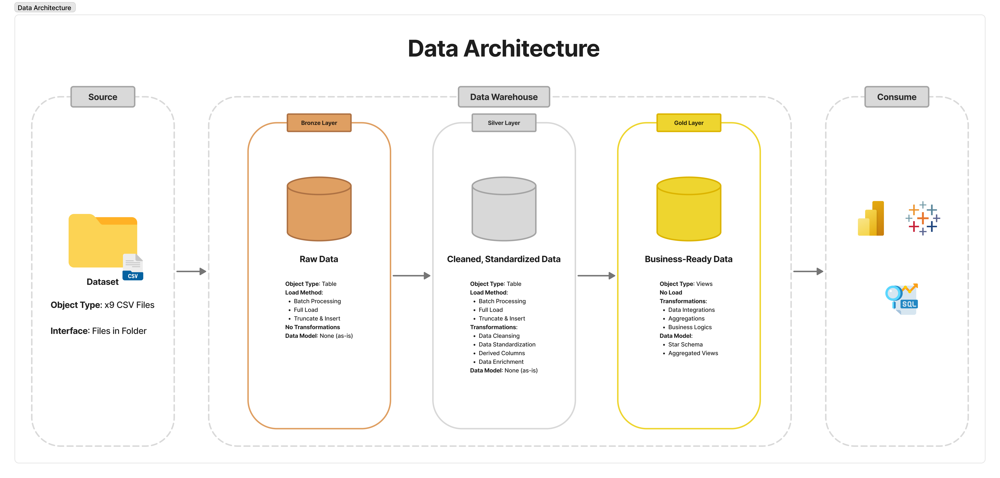

# Olist E-Commerce Data Analysis

Exploratory data analysis of the [Brazilian E-Commerce Public Dataset by Olist](https://www.kaggle.com/datasets/olistbr/brazilian-ecommerce) (about 100,000 orders, 2016–2018) in SQL Server 2022.

The project loads 9 CSV files into a Bronze → Silver → Gold warehouse, validates the data and answers three business questions with SQL.



## Business Questions and Key Results

| Block | Question | Key results |
|---|---|---|
| [Sales Performance](analysis/sales/sales_performance.md) | How are sales distributed across product categories? | Product Sales Value is 13.22M (delivered orders). The top 5 categories give 39.83%; health_beauty is first (9.33%). Monthly sales peaked in 2017-11 (987,765, +52.4% vs October). |
| [Orders & Delivery](analysis/orders_delivery/orders_delivery_performance.md) | How efficiently are orders fulfilled, and where do delivery issues arise? | 97.02% of orders were delivered, 93.23% of them on time; average delivery time is 12.5 days. Three months (2017-11, 2018-02, 2018-03) hold 48.33% of all late orders; Rio de Janeiro drives them. |
| [Customer Analysis](analysis/customers/customers_performance.md) | How do customers use the platform and how often do they return? | 97% of customers bought once. Repeat customers are 3% of customers but spend 1.89 times more per customer. Sao Paulo has 41.92% of customers. |

Each analysis file follows the same steps: question, context, metrics, data sources and grain, SQL, findings, interpretation, recommendations. Metric definitions are in [`docs/metric_definitions.md`](docs/metric_definitions.md).

## Data Layers

| Layer | Content |
|---|---|
| Bronze | 9 source-aligned tables loaded from CSV with `BULK INSERT` (full load, no transformations) |
| Silver | Cleaned and standardized tables: trimmed cities, full state names, corrected column names, 2 added category translations |
| Gold | 3 dimension views, 3 fact views (Fact Constellation Schema) and 3 report views for the business questions |

Data quality issues and handling rules are in [`docs/data_quality_report.md`](docs/data_quality_report.md); every Gold view is described in [`docs/data_catalog.md`](docs/data_catalog.md).

## Tech Stack

- SQL Server 2022
- SQL Server Management Studio (SSMS)
- Git / GitHub
- Figma (diagrams)

## Repository Structure

```
sql-ecommerce-eda-project/
├── datasets/     # dataset download instructions (CSV files are not stored in the repository)
├── scripts/      # database creation, Bronze → Silver → Gold ETL, report views
├── tests/        # data quality checks for Silver and Gold
├── analysis/     # EDA: sales, orders_delivery, customers (SQL and findings)
├── docs/         # architecture, data catalog, quality report, metric definitions
├── LICENSE
└── README.md
```

## How to Run

1. Install SQL Server (2022 or newer) and SSMS.
2. Download the CSV files (see [`datasets/README.md`](datasets/README.md)) and set the nine file paths in `scripts/bronze/dml_bronze.sql`.
3. Run `scripts/init_database.sql` (it drops and recreates the `olist_ecommerce` database).
4. Run `scripts/bronze/ddl_bronze.sql`, then `scripts/bronze/dml_bronze.sql`.
5. Run `scripts/silver/ddl_silver.sql`, then `scripts/silver/dml_silver.sql`, then `tests/quality_checks_silver.sql`.
6. Run `scripts/gold/ddl_gold.sql`, then `tests/quality_checks_gold.sql`, then `scripts/gold/ddl_gold_reports.sql`.
7. Run the queries in `analysis/<block>/`.

## Limitations

- The dataset has no product cost, so profit cannot be calculated.
- Sales and customer metrics use delivered orders only; 2016 has very low volume, so trends are interpreted from 2017-02.
- About 97% of customers have one order, and the observation period is about two years, so repeat behavior is limited.
- Findings are descriptive; causes are given as hypotheses.

## What I Learned

This was my first independent data analysis project. I practiced:

- **Data architecture:** designing a Bronze, Silver and Gold warehouse and documenting the data flow.
- **ETL and data quality:** loading CSV files, standardizing data and writing checks for each layer.
- **Data modeling:** a Fact Constellation Schema with 3 fact views and 3 dimension views.
- **Exploratory analysis:** defining metrics and grain before writing SQL, and separating findings from interpretation.
- **Documentation and Git:** a data catalog, a quality report, metric definitions and a structured repository.

## Next Steps

Build a dashboard on the Gold views in a BI tool (Power BI or Tableau).

## Acknowledgements

- Data: Olist, [Brazilian E-Commerce Public Dataset by Olist](https://www.kaggle.com/datasets/olistbr/brazilian-ecommerce), Kaggle.
- AI assistance: the business questions, SQL queries and analysis are my own work. I used an AI assistant (Claude) as a reviewer and writing assistant: it reviewed the structure and logic and suggested corrections, and helped draft the wording of the documentation and the findings. I checked the numbers against my query results.

## License

This project is licensed under the [MIT License](LICENSE).
The original [Brazilian E-Commerce Public Dataset by Olist](https://www.kaggle.com/datasets/olistbr/brazilian-ecommerce) is licensed under [CC BY-NC-SA 4.0](https://creativecommons.org/licenses/by-nc-sa/4.0/); see [`docs/dataset_sources.md`](docs/dataset_sources.md).
